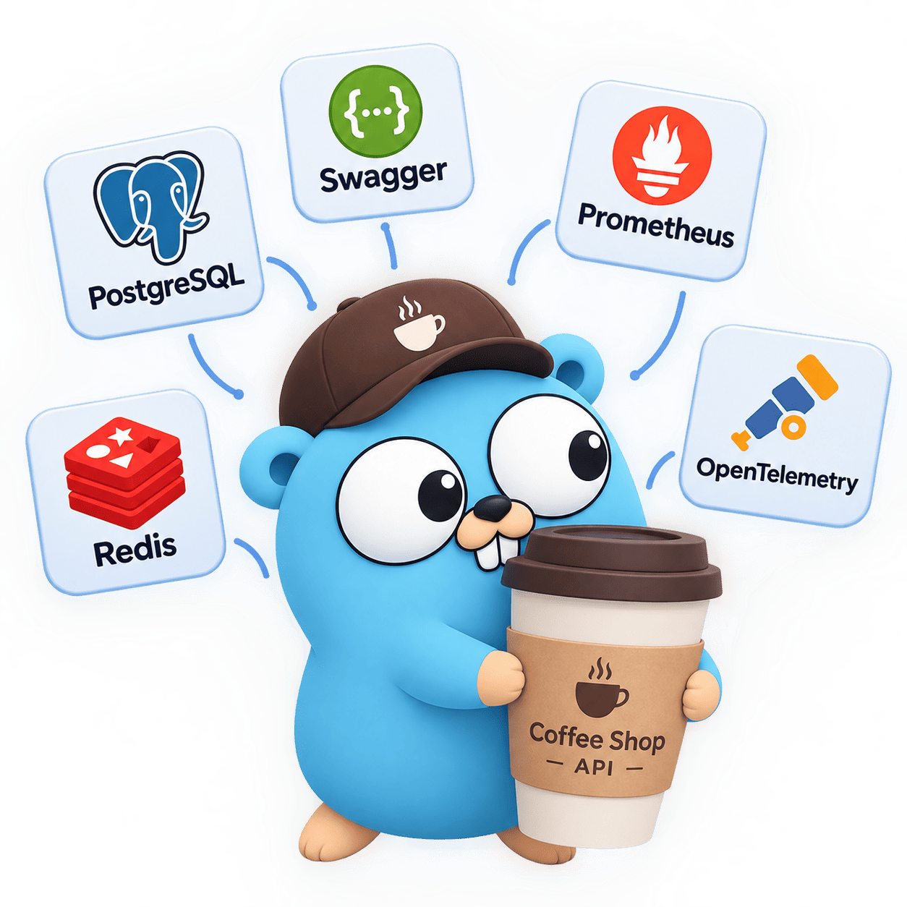
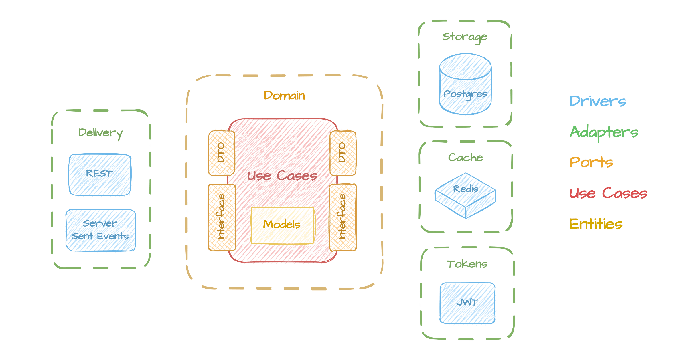

# Coffee Shop API

Example Go application with Clean Architecture pattern. \
Contains CRUD operations for `Users`, `Coffee` and `Orders` services.



**Tech Stack:**
> - Go
> - Redis
> - PostgreSQL
> - Swagger
> - Prometheus
> - OpenTelemetry

## Architecture

Architecture designed according to the SOLID and GRASP principles.



## Run

Save **[config.example.json](configs/config.example.json)** as **config.json**:
```bash
cp configs/config.example.json configs/config.json
```

Run with docker:
```bash
docker compose up --build
```

Check health:
```bash
curl localhost:1337/api/health
```

## Services

### API Documentation

Swagger available at [localhost:8080](http://localhost:8080/). You can also use **[requests.md](api/requests.md)** for make sample requests.

### Metrics

Prometheus available at [localhost:9090](http://localhost:9090/)

### Tracing

Jaeger available at [localhost:16686](http://localhost:16686/)

### Profiling

Pprof available at [localhost:6060](http://localhost:6060/)

### Migrations

Migrations are available via Goose and placed in **[migrations](migrations/)** dir:
```bash
make migration migration_name
```

### Errors

To generate custom errors add their descriptions to the **[errors.json](configs/errors.json)** file and run:
```bash
make errors
```

### Testing

To generate mocks:
```bash
make mocks
```

To run unit tests:
```bash
make test
```
